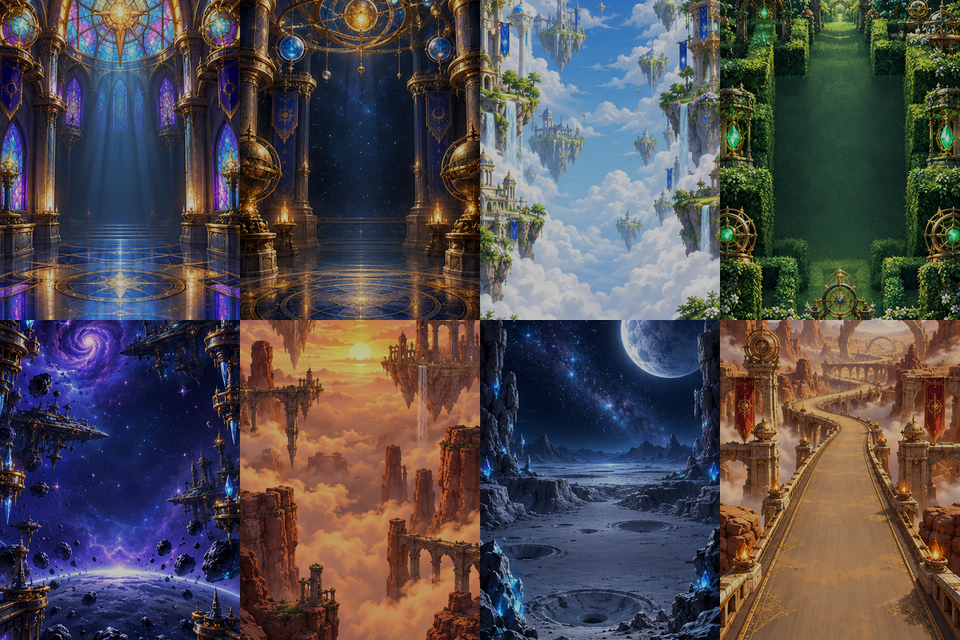

<strong>English</strong> · <a href="eight-realms.zh_CN.md">简体中文</a>

# 经典游戏合集-9款 (Nine Classic Arcade Games)

Classic Nine is an offline collection of nine short arcade games for the FoloToy AI Passport's 240 × 320 display and three physical buttons. It starts in an original gallery screen; UP and DOWN choose a game and OK starts it. Hold OK during a game to return to the gallery, except in Moon Return where holding UP exits, leaving OK available for sustained thrust. The former Star Orbit game is excluded because aiming it with three buttons did not produce a satisfactory control scheme.

The image is an asset preview, not a device photograph. The original eight hand-painted backgrounds and eight character/object sprites were generated for this project with the built-in image generation tool. `tools/generate_arcade_art.py` converts them to Flash-resident RGB565/RGB565A8; the app keeps no full-screen image in RAM. The collection reuses the original 16 kHz synthesized music and event cues from the prior app.

## Games and controls

| Game | UP / DOWN | OK | Goal |
| --- | --- | --- | --- |
| Glass Citadel (brick breaker) | Move paddle left / right; hold to continue | Launch ball | Break 12 bricks |
| Celestial Blocks (falling blocks) | Move piece left / right; hold to repeat | Click rotates; double-click drops | Clear six lines |
| Cloud Leap (vertical jumper) | Steer left / right | One boost per bounce | Climb 600 points |
| Jade Serpent (snake) | Turn relative left / right | Click toggles faster movement | Eat eight gems |
| Galactic Guard (vertical shooter) | Move ship left / right | Auto-fire; click toggles fire rate | Defeat 15 enemies |
| Sunset Wing (one-button flier) | Fine horizontal adjustment | Flap | Pass ten gates |
| Moon Return (lander) | Tap to rotate in steps; hold UP to exit | Hold to thrust | Land upright on the pad at safe speed |
| Desert Sprint (dodging racer) | Change lane left / right | Click toggles faster movement | Survive 25 seconds |
| Orbital Docking (6-DoF) | Thrusters in negative / positive direction of selected axis | Click cycles Z, X, Y, yaw, pitch, roll | Dock aligned, slowly, and safely |

The three keys share an ADC ladder, so games no longer rely on pressing multiple buttons at once. Shooting is automatic, speed boost toggles on click, and the lander uses stepwise turning while OK remains available for sustained thrust.

Games are deliberately short and use immediate PRESS events where response time matters. Tetris rotation uses the button's CLICK event, so it follows the driver's click recognition delay. The gallery shows the selected game's generated background; gameplay overlays small generated sprites and simple high-contrast obstacles. Idle time starts an nine-game attract mode, which also records bounded per-game performance telemetry. Any button exits the attract mode.

## Validation approach

Pure game logic runs without ESP-IDF or LVGL. Host tests cover all nine starts and controls, targeted victory paths for all nine games, Tetris placement, and 108 seeded 60-second simulated sessions under AddressSanitizer and UndefinedBehaviorSanitizer. The firmware gate checks the complete ESP-IDF 5.5.3 image and retains a matching ELF. On-device telemetry reports game-loop and LVGL render rates, SPI pixel traffic, worst game-loop interval, missed 50 ms intervals, free heap, and largest free block in five-second windows. A low LVGL rate in a mostly static game, such as falling blocks, does not by itself mean the game loop missed its 30 Hz target. Physical smoothness, screen legibility, audio, and three-button feel require a device observation.

## Device checkpoint

The verified app image was flashed at `0x10000` to an ESP32-C3 revision 1.1 AI Passport with 8 MB Flash. The existing partition table, NVS, PHY, and archive partition were preserved. Its SHA-256 is `b3487785644c44b52b32039f9619a41097b708126debf383d510b994e0eae150`; the matching full merged image is `e6bda2787afa544d3e839028b62f7db06d6d8c6fb5928dddae8734fbe385e6ce`. Boot, display, LVGL, buttons, and audio driver initialized without observed reboot or error logs. The original eight-game demo cycled through the eight games.

In five-second windows, game logic ran at 30.3–30.5 Hz in every game, worst loop interval was 33 ms, and no interval exceeded 50 ms. Free heap stayed at 221,428 bytes with a 114,688-byte largest block. The moving games rendered at 21.5–29.7 frames per second; mostly static Tetris and Snake rendered at 7.5 and 6.9 frames per second respectively. These results support stable game timing, but do not establish a visible 30 fps rate for every animation. Screen appearance, Chinese glyphs, audio output, and three-button feel have not yet been observed by a person.

## Ninth game: Orbital Docking

This is a self-contained inertial six-degree-of-freedom approach simulator, scaled for three ADC-ladder keys. UP/DOWN thrust along the current axis, OK click cycles the six axes, and long OK returns to the gallery. Translational and rotational velocities persist without artificial drag, requiring counter-thrust to brake. HUD shows selected axis, range and closing velocity. The docking-ring perspective responds to distance and offsets, while the fixed crosshair highlights angular alignment. Success requires slow translational and rotational velocities and correct position and orientation; contact too fast, timeout, or departure fails.

All docking scene and sprite source art was originally produced with the image generation tool. Smaller indexed/palette derivatives are committed as `assets/images/eight-realms/docking-*.b64`, decoded using only Python's standard library by `tools/decode_docking_assets.py` during host/firmware validation. The final 240x320 RGB565 background, 48x48 docking-port and 24x20 spacecraft RGB565A8 sprites are embedded into Flash. This device build has not yet been verified by a new physical-device test; prior eight-game physical measurements apply only to the former firmware.
