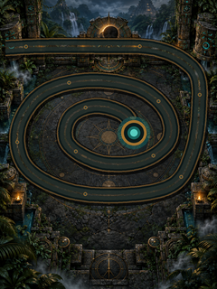

<a href="star-orbit.md">English</a> · <strong>简体中文</strong>

# 星环弹珠

《星环弹珠》是为 240 × 320 的 FoloToy AI Passport 制作的原创离线弹珠追逐游戏。风化观星遗迹、石雕轨道、玉石守护者和四种雕纹宝石弹珠组成神秘写实画面。图像为本项目原创生成，并转换为常驻 Flash 的 RGB565/RGB565A8 资源；游戏实际路径精准烘进背景。开机直接进入独立标题页。

上图只展示棋盘美术，不包含实时界面和弹珠，也不是真机照片。固件使用一张不透明的 240 × 320 背景和小型透明精灵，不会在内存中分配全屏图片。修改路径或源图后，运行 `python3 tools/generate_star_orbit_art.py` 重新生成二进制资源（需要 Pillow）。

## 操作

| 页面 | 上 / 下 | 确定 | 双击确定 | 长按确定 |
| --- | --- | --- | --- | --- |
| 标题 | 选择悠闲 / 经典 / 风暴 | 开始 | — | — |
| 游戏 | 转动瞄准方向，按住可连续转动 | 发射 | 交换当前与下一颗弹珠 | 暂停 |
| 暂停 | — | 继续 | — | 返回标题 |
| 胜利 / 失败 | — | 以相同难度重试 | — | 返回标题 |

三个及以上同色弹珠相邻时消除。消除后留下空隙，后段追上前段时若颜色匹配会引发连锁；队首也会短暂后退。连续形成的消除获得连击倍率。在队首抵达日蚀终点前清空有限数量的弹珠即可获胜。

三个难度分别改变队列速度和弹珠总量。底部显示分数及波次进度，右上角显示电量。独立任务以 16 kHz 合成原创五声音阶配乐，包含低音铺底、石鼓节奏和不同事件提示音；可[试听 16 秒主机预览](../assets/music/star-orbit-preview.wav)。音频芯片不可用时，游戏继续静音运行。

标题、难度选择、操作提示、暂停、胜利和失败界面现已改为简体中文。固定文字使用 14、16、20 像素的思源黑体简体中文子集字库，`python3 tools/generate_star_orbit_font.py --check` 可检查全部界面文字的字形覆盖。游戏中 LVGL 只重绘变化弹珠的范围、发射器和飞行弹珠，而不再每次更新都重绘整屏。游戏目标更新周期为 33 毫秒，每 5 秒通过串口输出一次游戏循环频率、LVGL 渲染频率和 SPI 刷新像素量。稳定 30 fps 仍需在实际游玩时测量；LVGL 计数不能代替物理屏幕测量。

## 验证记录

- 源码分支：`feature/zuma-three-key`，基于官方 `FoloToy/ai-passport` 的 `main`，基准提交 `a06235e`。
- 主机逻辑测试：`tests/test_zuma_game.c` 检查路径递增、难度、控制、消除、暂停及胜负，并运行 25 局带状态约束的固定种子长局。
- 图像预算：嵌入的背景与精灵共占 171,504 字节 Flash。与加入图像前的构建相比，链接器报告的静态内部 RAM 占用仍为 110,964 字节，运行时分配前剩余 210,332 字节。这是构建期预算，不是真机测得的空闲堆。
- 真机仍需检查：最终图像效果与 30 帧节奏、三键方向与长按时序、发射时配乐有无断续、电量显示以及胜负转换。

## 真机阶段记录（2026-10-11）

用户授权将 SHA-256 为 `cd5e03a78cc54d6097f148a16187815240f6d97e48a0bb376666727762f2565e` 的已验证固件刷入 `/dev/cu.usbmodem101`。只读检查发现设备现有分区表在 `0x400000` 有 4 MB 的 `archive` 数据分区；新版默认分区表会将此区域划给 factory 应用。为保留现有分区表、NVS、PHY 和 archive 数据，仅将已校验的应用镜像（`0f3c32c6051aba7892b1dc4bd7cee851f516ec734329d689b26a1528a6ece5e1`）写入 `0x10000`。应用可装入设备现有的 4032 KB factory 分区，esptool 已校验写入数据的哈希。

限时串口监视记录到显示屏（240 × 320）、LVGL、按键、电量计、ES8311 音频芯片和 16 kHz 单声道输出均完成初始化，随后 10 秒没有新错误。新一轮游戏状态机与音频合成器的主机模拟、AddressSanitizer 和 UndefinedBehaviorSanitizer 检查均通过。实际帧率、机身画面、扬声器效果、按键响应与完整胜负流程仍需用户观察。

上述真机记录仅对应所列旧版固件；中文版有下方单独的真机记录。

## 中文界面与 30 fps 阶段记录

在 ESP-IDF 5.5.3 下，完整静态与固件门禁均通过。当前已验证合并镜像的 SHA-256 为 `35419fd7f59a4fb15d614ca87298108920189f4ea9989f8e9e77dcbb6a0577a4`，应用镜像 SHA-256 为 `1de0e5198136d30701392c0b61d06da46c1f68549d9d5591ba1cd0278ec0833e`。应用镜像为 900,640 字节，可装入设备的 4032 KB factory 分区。固定界面与 ASCII 共 143 个字符，三个已编译字级均覆盖。

用户授权将此版刷入 `/dev/cu.usbmodem101`。只读检查再次确认同一台 ESP32-C3 和现有分区表。仅在 `0x10000` 写入应用镜像，保留分区表、NVS、PHY 和 archive。esptool 校验写入数据的哈希。串口监视记录到匹配的 ELF（`f74ce16dd6fce4c77e1b711ba08950ec1044fc75f00bb6dddd79c21e45dc02de`）正常启动，显示屏、LVGL、按键、电量计、ES8311 和 16 kHz 单声道输出均完成初始化。对局帧率实测以及画面和音频验收仍待进行。
