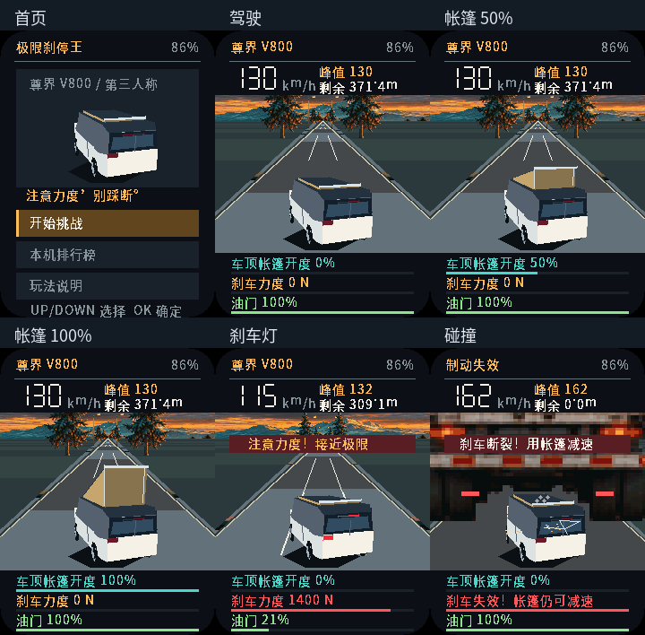

<strong>简体中文</strong> · <a href="README.md">English</a>

# Brake Hero 2.0 已验证固件

下载 [Brake-Hero-v2-full.bin](Brake-Hero-v2-full.bin)，适用于 FoloToy AI Passport（ESP32-C3、8 MB Flash、240 × 320 屏幕）。这是从 **0x0** 写入的完整合并镜像，可能清除 NVS 设置及成绩；操作前确认设备与数据影响，不要例行整片擦除。

第三人称尊界 V800 外观低多边形车辆具有与开度同步的帐篷升降、有效制动尾灯、碰撞变形、玻璃裂纹、碎片和扬尘。驾驶提示已中文化。使用面板 DMA 直送和更高优先级的音频任务，替换旧的整屏 LVGL 渲染路径。模型及损毁是原创游戏表现，不是厂商 CAD 或真实碰撞预测。

- 版本：**2.0.0**。
- Build：**PASS**，ESP-IDF 5.5.3，镜像/分区和匹配 ELF 归档验证通过。
- Host tests：**PASS**，包括 10000 条驾驶轨迹、连续 PCM 完整采样、尾灯/帐篷/损毁状态、DMA 边界/线序、检测器及基线 BSP/工作流测试。
- 编译资源：**PASS**，22 个已链接字节数组和 271 个字形与匹配 ELF 比较通过。
- 完整仓库门禁：**FAIL**，基线已有 WorldCam README 双语错误，未屏蔽。
- Device tests：新镜像 **NOT RUN**。实际帧率、听感、屏幕、按键、看门狗稳定性和 NVS 成绩恢复仍需真机验收，旧镜像的设备故障记录不作为新版通过依据。

大小：**949648 字节**。SHA256：

`6814d7f5e7faad12976ed451921c910ba50a43dde899b343c518cf59bdcc9629`

匹配 ELF SHA256：`6fb2c63832aa92c46e8319d01511cb17ca1f88b28a5c6a74df30f50840fd0bd4`。ELF/MAP 仅本地保留，不发布到此固件目录。

本次已同时上传[完整修复源码](https://github.com/name8266/ai-passport/tree/00cb40628c79ea74f9c9161e2dec46e858005dd9)，不再只有 bin。本产物分支的仓库根目录也包含该源码；[源码/构建清单](Brake-Hero-v2-manifest.json)记录精确编译输入。使用保留的生成 C 资源即可构建，无需图片或语音服务。

