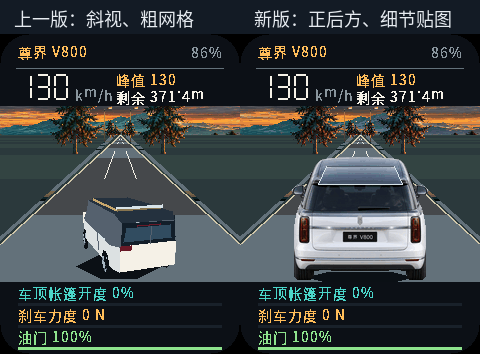

<strong>简体中文</strong> · <a href="README.md">English</a>

# 刹车英雄 2.1.0

[下载完整固件](Brake-Hero-v21-full.bin) · [完整源码](https://github.com/name8266/ai-passport/tree/4c468d458756844ee2899ffbdfb506c835bea949) · [构建清单](Brake-Hero-v21-manifest.json)

采用居中的正后方视角，修正车辆与道路的透视不一致。使用更细致的生成式尊界 V800 车身贴图替代粗糙网格，帐篷开度、刹车灯、裂纹、尘土和碎片仍在运行时动态绘制。该素材是游戏美术，并非厂商 CAD 模型；损毁效果不属于物理碰撞仿真。保留 v2 的中文操作提示和连续音频任务。

预览使用固件同一套渲染器，以 240 × 320 分辨率输出，并非实机照片。[查看全部动画状态](Brake-Hero-v21-preview.png)。源码保留[生成素材、完整提示词和来源](../../assets/images/brake-hero/source/vehicle-rear-v21-prompt.txt)，车身素材使用内置图片生成工具制作。

- Build：PASS。ESP-IDF 5.5.3、ESP32-C3、8 MB、无 PSRAM；完整镜像及匹配归档已校验。
- Host tests：PASS。玩法逻辑、一万条模拟轨迹、音频连续性、车身居中、帐篷/车灯/损毁动画、渲染与 DMA 边界、中文字体覆盖；ASan/UBSan 通过。
- Device tests：NOT RUN。v2.1 尚未刷入，实机音频连续性、帧率、看门狗、屏幕和按键仍待验收。
- 仓库完整检查：FAIL。现有 `worldcam-site/README.md` 有英文正文和缺少中文配对文件问题。固件构建及应用检查已单独通过。

完整镜像大小 962880 字节，刷写起始地址 `0x0`。完整刷写可能重置设置和成绩。目前尚未刷入 v2.1。匹配的 ELF/MAP 调试文件保留在本地，未公开上传。

完整固件 SHA-256：`263cee0ff1d26b0df03d0a4d95bb45c18f69538f85cc69e023f63ab3e6c8143c`

匹配 ELF SHA-256：`af6a87decba67ae72ef10893bc7e9053c74f9120f22286b6b51778de926bb235`
